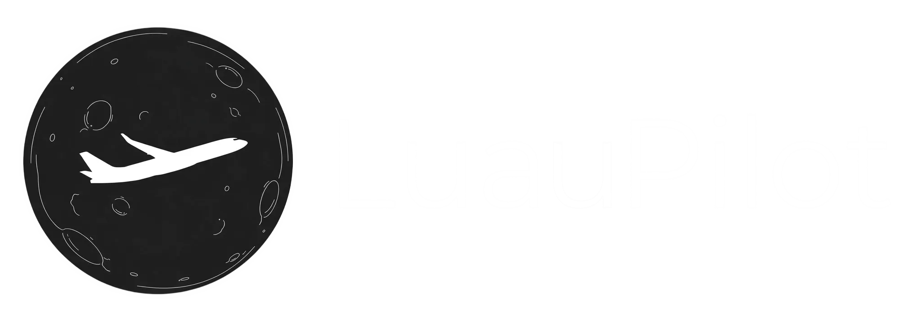
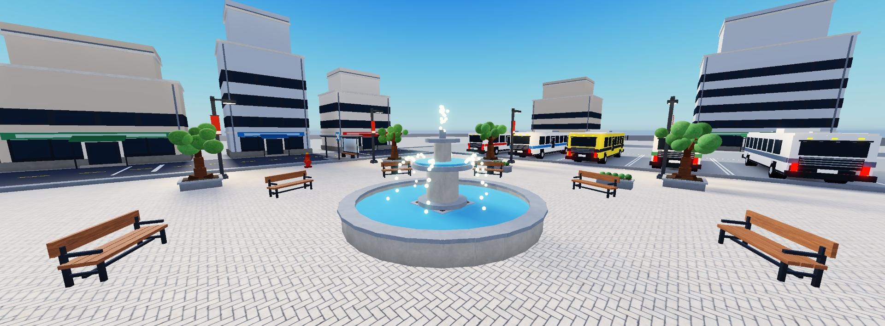

# LuauPilot

> [!NOTE]
> **The project has been renamed to LuauPilot.**
>
> The name was changed because **LuaPilot.com already exists and provides a very similar product**.
>
> The rebranding is now in progress. Until a new release is published, some versions available in the **Releases** section may still use the old **LuaPilot** name. Older releases may also continue to use the old name, application branding, and paths.
>
> **The project itself is not discontinued.**

LuauPilot lets a DeepSeek chat work inside your **Roblox Studio**. A browser extension reads the AI's commands, a small local bridge passes them to Roblox Studio's MCP server, and the results go back into the chat — so the AI can keep working on its own.

> Use at your own risk. Provided "as is", no support obligation. Read [TERMS.md](TERMS.md). Not affiliated with any AI creator, any AI, or Roblox.

## What's new in 0.03

- **Background tab support** — the extension tab no longer goes to sleep when running in the background, keeping LuauPilot responsive even when you're working in another tab.
- **General improvements** — improved stability, performance and overall reliability.
- **Various fixes** — cleaned up several smaller issues across the extension.

LuauPilot is still in alpha, so more improvements and fixes are coming.

## Generated with LuauPilot

  

## Install (Windows)

1. Run `windows.exe` (the installer; build it with `installer\build.bat`, see below). Attach it to your GitHub release under exactly that name: the in-app updater looks for it.
2. Open **LuauPilot**. Press **Extension** — the extension folder path is copied to your clipboard.
3. In Chrome/Edge open `chrome://extensions`, enable *Developer mode*, click *Load unpacked*, paste the path (Ctrl+V) and confirm.
4. Open Roblox Studio with a place and enable its MCP server (Assistant settings).
5. Open <https://chat.deepseek.com/>, press **Start LuauPilot here** (optionally type your task first).

In the app's **Settings** you can make it open DeepSeek and Roblox Studio automatically when it starts.

## Mini chat

> **Experimental feature:** Mini chat is currently in testing and is not recommended for regular use. It may be unstable or behave unexpectedly.

Press **Mini chat** in the app: a small always-on-top box (Send, Stop, expandable answer) that talks to the DeepSeek tab through the extension, so you can keep Roblox Studio in front. It needs the DeepSeek page open in the browser (it can sit in the background or a minimised window): the AI lives on that page. If it is not open, the box offers **Open DeepSeek** and sends your message as soon as the page is connected.

## Roblox catalog

The AI can call `catalog_search` / `catalog_images` (answered by the bridge) to browse free Creator Store assets, look at their thumbnails and then insert the one it picks with `insert_from_creator_store`.

When you press **Start LuauPilot here** in a fresh chat you are asked two things: allow the catalog in this session, and use Blender.

## Blender (optional, per session)

> **Experimental feature:** Blender integration is currently in testing and is not recommended for regular use. It may be unstable or behave unexpectedly.

Pick **Use Blender** at the start. The bridge then starts the community `mcp-for-blender` server (via `uvx`, telemetry off) next to the Studio one; its tools appear as `blender_...`. It needs [uv](https://docs.astral.sh/uv/), Blender, and the add-on (`uvx mcp-for-blender install-addon`, then enable "MCP for Blender" and start its server in the N panel, port 9876). If something is missing the page shows the exact steps. Models are exported from Blender and imported into Studio by you once (MCP cannot upload meshes); then the AI continues in Studio.

## Guide for the AI

Press **Guide** in the app to open your guide folder (`~/LuauPilot/Guide`): `AGENT_INSTRUCTIONS.md` (how to work), `STYLE_GUIDE.md` (how the project looks), `GAME_DESIGN.md` (long handbook, read in chapters), `ASSETS.md` (approved/rejected asset ids), `KNOWN_ISSUES.md` and `REFERENCES/` (your example pictures named `oldcity.png`, `mainmenu.png`, ...). Edit them freely; the AI reads the essentials at the start of every session and can ask for more with `style_guide` and `reference_images`. Defaults are only copied once and never overwritten. Per-project decisions go into `ServerStorage.LuauPilot.Memory` inside your place.

---

**Made with Claude AI.**

License: MIT.
